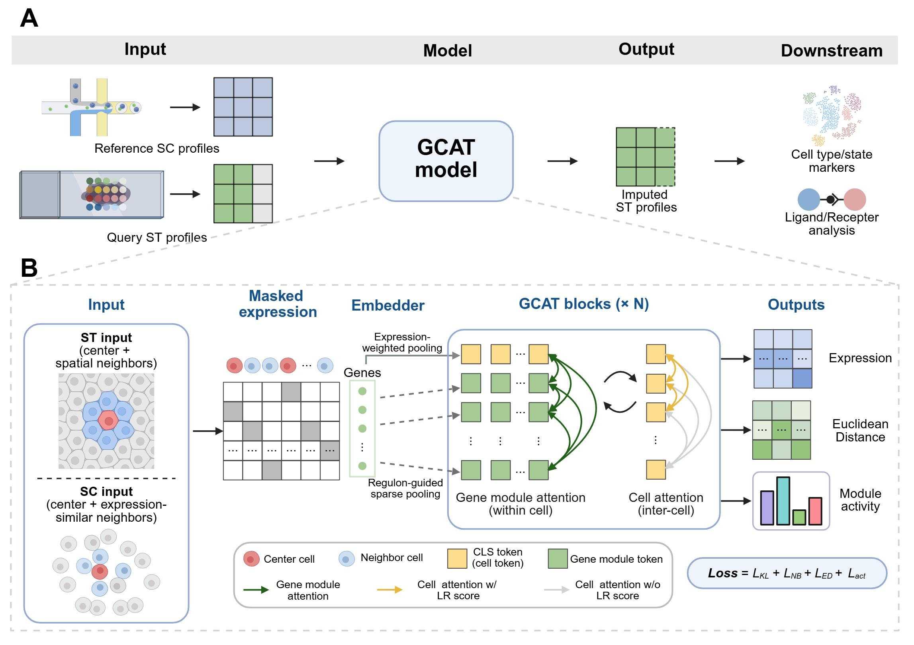
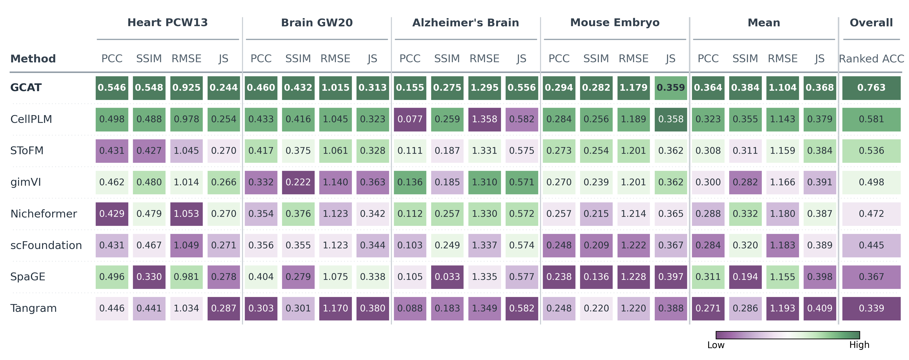

# GCAT

### A gene and cell attention transformer for spatial gene imputation

GCAT integrates a targeted spatial transcriptomics (ST) dataset with a matched single-cell RNA-seq (SC) reference to infer gene expression beyond the measured spatial panel. It combines intracellular regulatory programs with intercellular context through alternating gene-module and cell attention.

GCAT is trained end to end from random initialization, without large-scale pretraining. This repository provides the GCAT implementation, regulatory priors, and training and evaluation workflows.

## Framework



**Figure 1 | Overview of GCAT.** (A) Query ST profiles and a matched SC reference are integrated to recover spatial gene expression for downstream cell-type, cell-state, and ligand-receptor analyses. (B) GCAT alternates within-cell gene-module attention and cross-cell attention, with module-activity-guided ligand-receptor information incorporated in the final cell-attention layer. Training combines gene-expression, spatial-distance, and module-activity reconstruction with variational regularization. Figure created in BioRender.

### Key components

- **Regulatory gene-module tokens:** sparse assignments initialized from TF-centered CollecTRI regulons, supplemented by de novo modules for genes outside the prior.
- **Gene attention transformer (GAT):** within-cell attention over regulatory modules to capture coordinated gene-expression programs.
- **Cell attention transformer (CAT):** cross-cell attention over spatial neighbors for ST cells and expression-similar neighbors for SC cells.
- **Flow-aware attention:** module activities modulate ligand-receptor-informed information exchange in the final CAT layer.
- **Generative reconstruction:** a variational latent representation and negative-binomial expression decoder support gene-expression recovery.

## Benchmark results



**Figure 2 | Benchmark comparison reported in the manuscript.** GCAT is compared with Tangram, SpaGE, gimVI, CellPLM, scFoundation, Nicheformer, and SToFM on Heart PCW13, Brain GW20, Alzheimer's brain, and mouse embryo datasets using five-fold gene cross-validation. Higher PCC, SSIM, and ranked ACC and lower RMSE and JS indicate better performance.

In the manuscript benchmark, GCAT achieved the highest overall ranked ACC (0.763) and the best mean performance across all four metrics. Mean PCC and SSIM improved by 12.7% and 8.2%, respectively, relative to the second-best model. These are manuscript results, not measurements generated by a new run of this repository.

## Installation

Clone the repository and create the supplied Python 3.10 environment:

```bash
git clone https://github.com/Minos0419/GCAT.git
cd GCAT
conda env create -f environment.yml
conda activate gcat
```

The environment targets PyTorch 2.5.1 with CUDA 11.8 and PyTorch Geometric 2.7.0. A compatible NVIDIA GPU is required for FP16 training. See [requirements.txt](requirements.txt) for dependencies.

The recorded reproduction environment is available in [configs/reproduction_environment.json](configs/reproduction_environment.json).

## Data preparation

Preprocessed expression datasets are **not included**. Organize the ST query and SC reference files under a single data directory:

```text
data/
├── AD_st.h5ad
├── AD_sc.h5ad
├── ME_st.h5ad
├── ME_sc.h5ad
├── Brain_GW20_st.h5ad
├── Brain_GW20_sc.h5ad
├── Heart_PCW13_st.h5ad
└── Heart_PCW13_sc.h5ad
```

| Dataset | Description |
| --- | --- |
| `AD` | Alzheimer's brain |
| `ME` | Mouse embryo |
| `Brain_GW20` | Human brain at gestational week 20 |
| `Heart_PCW13` | Human heart at post-conception week 13 |

Set the query and reference paths in [configs/benchmarks.json](configs/benchmarks.json) to match these filenames before running.

Inputs must use gene identifiers compatible with [assets/config.json](assets/config.json), the supplied regulon priors, and the ligand-receptor resource. ST inputs must provide spatial coordinates, normally in `adata.obsm["spatial"]`. Preflight checks input existence, shared genes, disjoint five-fold coverage, expected fold sizes, and ligand-receptor program counts before training.

Regulon initializations are included under `assets/regulons/`. The required `assets/interactions_human__ensembl_lr.pt` file is a ligand-receptor resource, **not a pretrained model checkpoint**.

## Quick start

Run commands from the repository root, replacing `/path/to/data` with your prepared data directory. Use [scripts/run_benchmark.py](scripts/run_benchmark.py) as the entry point; [configs/benchmarks.json](configs/benchmarks.json) is the canonical source of benchmark settings.

### 1. Validate inputs without training

```bash
python scripts/run_benchmark.py AD \
  --data-root /path/to/data \
  --out results/AD_check \
  --check-only
```

### 2. Run one fold

```bash
python scripts/run_benchmark.py AD \
  --data-root /path/to/data \
  --folds 0 \
  --device cuda:0 \
  --out results/AD_run
```

### 3. Complete the remaining folds

```bash
python scripts/run_benchmark.py AD \
  --data-root /path/to/data \
  --folds 1 2 3 4 \
  --device cuda:0 \
  --out results/AD_run \
  --resume
```

Omit `--folds` to run all five folds in a new output directory. Replace `AD` with `data1`, `dev_brain`, or `heart_pcw13` to select another profile. `--resume` requires matching inputs, source code, and options; it reuses completed folds rather than resuming an interrupted training epoch. Use a fresh output directory for an interrupted, incomplete run.

The default data root is `../../data` relative to the repository directory. Passing `--data-root` explicitly is recommended for a standalone clone. The archived benchmark uses fast, non-deterministic training; `--deterministic` selects a separate diagnostic protocol.

## Outputs and reproducibility

Each training run records:

- `run_manifest.json`: input/source SHA-256 hashes, effective options, software/GPU metadata, and fold status.
- `foldN/`: training logs, epoch histories, predictions, and gene-level and summary scores.
- `ccc_cache/`: run-specific ligand-receptor graph/program caches with provenance checks.
- `merged/`: combined evaluation outputs after all five folds complete.

The evaluation metrics are PCC, SSIM, RMSE, and JS divergence. The runner verifies prediction gene order and complete fold coverage before merging. Experimental outputs, model checkpoints, and local experiment notes are excluded from Git by default.

## Repository structure

```text
GCAT/
├── assets/          # Gene configuration, regulon priors, and LR resource
├── configs/         # Benchmark profiles and packaged masks
├── docs/figures/    # Manuscript Figures 1 and 2
├── gcat/            # Data loading, model components, and evaluation
├── scripts/         # Benchmark runner and training entry points
├── tests/           # Model and benchmark regression tests
├── tools/           # Fold merging, comparisons, and audit utilities
├── environment.yml
└── requirements.txt
```

## Tests

In the configured environment:

```bash
python -m unittest discover -s tests -v
```

## Manuscript

**GCAT: A gene and cell attention transformer for spatial gene imputation.**

Figures 1 and 2 above are reproduced from the accompanying manuscript. Publication metadata and a formal citation will be added when available.
